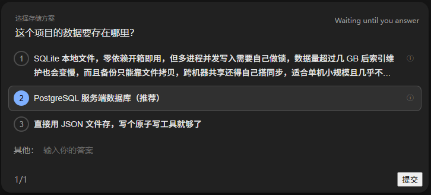
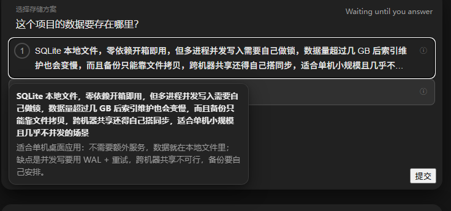
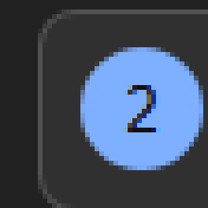
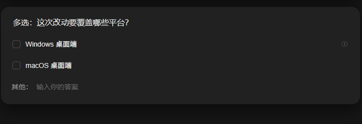

# dsh-question

Compact question cards for [DeepSeek Harness](https://github.com/deepseek-ai/deepseek-harness) (DSH).

The built-in `ask_user_question` card prints the asker's full option description inline, which makes
rows bulky and hard to scan. This plugin turns it into a hover-first card:

- **Options show only the key point** — the short label, clamped to two lines;
- **Hover reveals the full explanation** — a floating tooltip with the asker's `description`
  (a truncated label gets its full text on the tooltip's first line);
- **“其他：” (Other:) is a first-class row** — the free-form answer row starts with the prefix and a
  plain input, no pencil icon needed;
- **26px circular radios** for single-select, native checkboxes for multi-select;
- **Keyboard shortcuts** — `1`–`9` select/toggle, `Enter` runs the primary footer action
  (submit / next), `Esc` collapses the card (it never cancels the question batch).

It is a **presentation-only client plugin**: the model-facing tool schema is untouched, the card's
React component is not replaced, and no nodes are injected into React's tree.

[English](README.md) | [中文](README.zh.md)





| Single-select radio (8×) | Multi-select |
| --- | --- |
|  |  |

## Requirements

- DSH **0.2.1-rc.x** Web / Desktop client (the card rendered by
  `@deepseek-ai/dsh-client-ui-user-questions`);
- Node.js ≥ 20 only if you build the bundle yourself (the published bundle is plain JavaScript).

Selectors match DSH's CSS-module class **suffixes** (`_optionLabel`, `_description`, `_customRow`, …)
and the `data-question-key` attribute, so a DSH CSS hash change is harmless — a structural UI refactor
is not.

## Install

### From GitHub

```powershell
dsh plugin --profile <profile> add github:1234ab484/dsh-question
```

pnpm clones the package from `https://github.com/1234ab484/dsh-question`; profiles with client HMR
apply it live. To remove it: `dsh plugin --profile <profile> remove dsh-question`.

### From a local checkout

```powershell
git clone https://github.com/1234ab484/dsh-question
dsh plugin --profile <profile> add "link:<path-to-this-repo>"
```

### Manual

1. Add `"dsh-question": "link:<path-to-this-repo>"` (or the GitHub spec) to the profile's `package.json`
   dependencies;
2. Append `dsh-question` to `dsh.profile.bundles`;
3. Run `pnpm install` in the profile directory.

The package carries `dsh.bundle.patch` (`cordis.patch.yml`, which inserts the `question-card` loader
entry) and `dsh.client` (`platform: "web"`, serving `./client` → `lib/client.js`).

## Keyboard shortcuts

| Key | Action |
| --- | --- |
| `1`–`9` | Select the Nth option (single-select) / toggle it (multi-select) |
| `Enter` | Run the primary footer action: submit on the last question, next otherwise |
| `Esc` | Collapse the card (same as the header collapse button; never cancels the batch) |

Shortcuts only act while a question card is visible, never while focus is inside `input`,
`textarea`, or a content-editable area, and never with `Ctrl`/`Alt`/`Cmd` held.

## How it works

1. **Stylesheet** (`lib/dsh-question.css`, injected as `<style data-plugin="dsh-question">`) — scoped to
   `[data-question-key]`, hides the inline `*_description`, clamps labels, draws the circular radios
   and the `其他：` prefix, styles the tooltip with theme tokens.
2. **Interaction** (`lib/client.js`) — one delegated `mouseover`/`focusin` listener plus a
   `position: fixed` tooltip; it reads the description text still present in the DOM. Nothing is added
   inside React's tree, so selection, paging and re-renders cannot wipe the enhancement.
3. **HMR-safe** — `apply()` disposes the previous generation (`window.__DSH_QUESTION_CARD__`), so a
   hot-reloaded bundle never stacks listeners.

## Development

```bash
npm run build   # src/*.js + lib/dsh-question.css -> lib/client.js
npm run check   # node --check
npm test        # node:test static contract tests
```

Open `dev/preview.html` in a browser for a standalone replica of the card DOM (no DSH required); hover
an option to see the tooltip.

```
src/10-helpers.js   shared DOM helpers
src/20-tooltip.js   tooltip element, stylesheet injection
src/30-mount.js     apply(): listeners, idempotent teardown
src/40-keys.js      keyboard shortcuts
```

## Known limitations

- The `其他：` prefix is Chinese; change the `content` value in `lib/dsh-question.css` for other locales.
- Tooltip content comes from the asker's `description`; without one, only a truncated label falls back to
  the tooltip.
- Plan-review (`exit_plan_mode`) cards are intentionally untouched.
- Depends on DSH's internal class suffixes and `data-question-key`; a structural refactor of the question
  card needs selector updates.

## License

[MIT](LICENSE)
