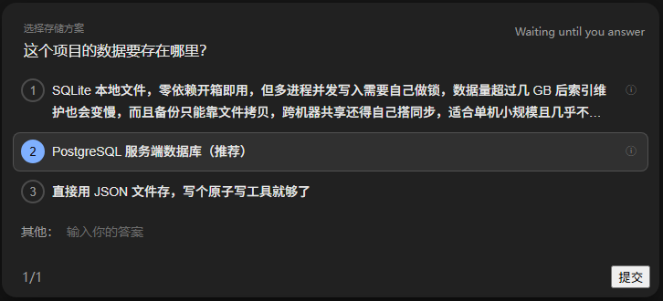
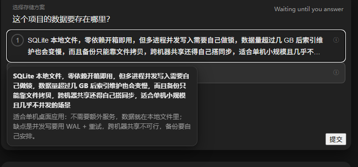
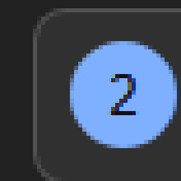
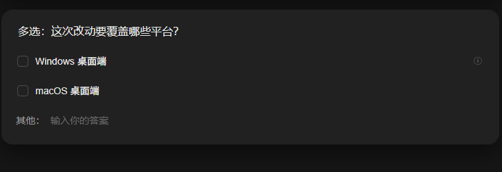

# dsh-question

给 [DeepSeek Harness](https://github.com/deepseek-ai/deepseek-harness)（DSH）的提问卡片插件。

`dsh-question` 把模型发起的提问渲染成一张可就地作答的卡片：选择选项、悬停查看详细说明，或者直接输入
自己的答案。你提交之前它会一直等你，答案回传给模型后继续工作。

[English](README.md) | [中文](README.zh.md)





| 单选圆钮（8×） | 多选 |
| --- | --- |
|  |  |

## 功能介绍

- **选项只显示重点** —— 每个选项行只留简短 label，最多两行，超出省略；
- **悬停看详细说明** —— 鼠标悬停或键盘聚焦选项时，浮层展示完整说明；label 被截断时浮层第一行补完整 label；
- **自由输入一行搞定** —— 自定义答案行显示「其他：」/“Other: ”并直接给输入框，不再需要铅笔图标；
- **单选与多选** —— 单选是 26px 圆形单选框，多选保留原生方框；
- **键盘操作** —— `1`–`9` 选择/勾选，`Enter` 触发主按钮（提交/下一题），`Esc` 收起卡片且不会取消整组问题；
- **等你作答** —— 未提交前这一轮保持等待；倒计时、跳过、多题翻页等行为照常；
- **中英文自动切换** —— 界面语言变，卡片文案跟着变，无需手动改配置。

插件负责提问卡片的呈现与交互，不改变模型可见的工具约定。

## 安装说明

### 从 npm 安装

```powershell
dsh plugin --profile <profile> add dsh-question
```

### 从 GitHub 安装

```powershell
dsh plugin --profile <profile> add github:1234ab484/dsh-question
```

### 从本地 checkout 安装

```powershell
git clone https://github.com/1234ab484/dsh-question
dsh plugin --profile <profile> add "link:<path-to-this-repo>"
```

### 手动安装

1. 在 profile 的 `package.json` 依赖里加 `"dsh-question": "<npm 版本 | GitHub spec | link:<路径>>"`；
2. 把 `dsh-question` 追加到 `dsh.profile.bundles`；
3. 在 profile 目录执行 `pnpm install`。

卸载：`dsh plugin --profile <profile> remove dsh-question`。

包内声明了 `dsh.bundle.patch`（`cordis.patch.yml`，插入 `question-card` 这条 Loader 条目）和
`dsh.client`（`platform: "web"`，把 `./client` 指向 `lib/client.js`）。启用了客户端 HMR 的 profile 会在线生效。

## 语言

插件自动跟随 DSH 的界面语言：

| DSH 界面语言 | 自定义答案行前缀 |
| --- | --- |
| 中文 | 其他： |
| English | Other: |

卡片上的其它文字（问题、选项、说明）来自模型，按原样展示。

## 键盘快捷键

| 按键 | 行为 |
| --- | --- |
| `1`–`9` | 选中第 N 个选项（单选）/ 勾选或取消（多选） |
| `Enter` | 触发右下角主按钮：最后一题提交，多题时下一题 |
| `Esc` | 收起卡片（等同标题栏收起按钮；**不会**放弃整组问题） |

快捷键只在提问卡片可见时生效；焦点在 `input`、`textarea` 或可编辑区域时不拦截；带 `Ctrl`/`Alt`/`Cmd`
的组合键不处理。

## 实现原理

1. **样式层**（`lib/dsh-question.css`，以 `<style data-plugin="dsh-question">` 注入）—— 作用域限定在
   `[data-question-key]`；隐藏行内 `*_description`、截断 label、画圆形单选框、「其他/Other」前缀和浮层。
2. **交互层**（`lib/client.js`）—— 委托的 `mouseover`/`focusin` 监听 + `position: fixed` 浮层，读取 DOM 里
   仍然存在的 description 文本；键盘处理；前缀通过 `MutationObserver` 跟随 `<html lang>`。
3. **HMR 安全** —— `apply()` 先销毁上一代（`window.__DSH_QUESTION_CARD__`），热重载不叠加监听器。

## 环境要求

- DSH **0.2.1-rc.x** 的 Web / 桌面客户端；
- 只有自己构建 bundle 时才需要 Node.js ≥ 20（发布出来的 bundle 是纯 JavaScript）。

选择器匹配 DSH CSS Module 的**类名后缀**（`_optionLabel`、`_description`、`_customRow` 等）和
`data-question-key` 属性，DSH 改变 CSS 哈希不影响插件；但卡片结构大改时需要更新选择器。

## 开发

```bash
npm run build   # src/*.js + lib/dsh-question.css -> lib/client.js
npm run check   # node --check
npm test        # node:test 静态契约测试
```

浏览器打开 `dev/preview.html` 可以脱离 DSH 预览卡片 DOM（悬停选项可看浮层）。

```
src/10-helpers.js   DOM 辅助与语言判断
src/20-tooltip.js   浮层元素、样式注入
src/30-mount.js     apply()：监听器、语言同步、幂等销毁
src/40-keys.js      键盘快捷键
```

## 已知限制

- 自定义答案行前缀只覆盖中文和英文，其它语言回退到英文；
- 浮层内容来自提问方的 `description`；没有 description 时，只有 label 被截断才会回退到浮层显示完整 label；
- plan-review（`exit_plan_mode`）卡片不在改动范围内，保持原样；
- 依赖 DSH 内部的类名后缀和 `data-question-key`，卡片结构大改时需要更新选择器。

## 许可证

[MIT](LICENSE)
